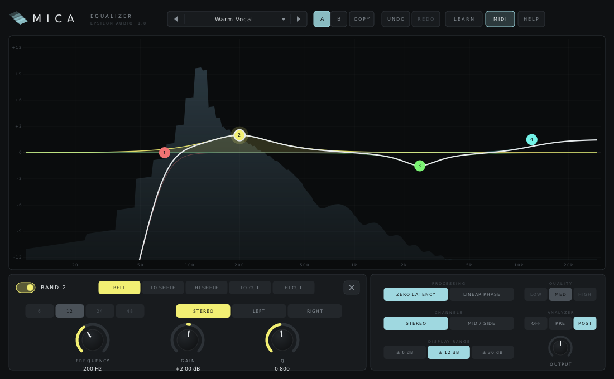

# Mica 2.1 — User Manual

Mica is a 24-band stereo equalizer. It has:

- **Ten band shapes**: bell, low and high shelf, low and high cut, notch, band pass, tilt shelf, flat tilt and all pass.
- **Slopes** from 6 to 96 dB per octave, plus a brickwall cut.
- **Dynamic EQ** on every band, with spectral dynamics and an external sidechain.
- **Three processing modes**: zero latency, natural phase and linear phase.
- **Gentle and Warm character** modes.
- **Stereo or mid/side** processing, with per-band channel selection.
- **Editing aids**: EQ Sketch, EQ Match and Spectrum Grab.
- **A full-featured spectrum analyser**: external spectrum, collision detection, freeze and a piano display.

Mica runs as VST3, AU, CLAP and VST2 on macOS, Windows and Linux.

**Contents**

1. [Installing](#1-installing)
2. [A quick tour](#2-a-quick-tour)
3. [Working with bands](#3-working-with-bands)
4. [Band shapes and slopes](#4-band-shapes-and-slopes)
5. [The band panel](#5-the-band-panel)
6. [Dynamic EQ](#6-dynamic-eq)
7. [Spectral dynamics](#7-spectral-dynamics)
8. [Processing modes](#8-processing-modes)
9. [Character, auto gain, gain scale and invert](#9-character-auto-gain-gain-scale-and-invert)
10. [Stereo and mid/side](#10-stereo-and-midside)
11. [The analyser](#11-the-analyser)
12. [EQ Sketch, EQ Match and Spectrum Grab](#12-eq-sketch-eq-match-and-spectrum-grab)
13. [The sidechain input](#13-the-sidechain-input)
14. [A/B, undo and redo](#14-ab-undo-and-redo)
15. [MIDI Learn](#15-midi-learn)
16. [Presets](#16-presets)
17. [Help and hover tips](#17-help-and-hover-tips)
18. [Recipes](#18-recipes)
19. [Keyboard and mouse reference](#19-keyboard-and-mouse-reference)
20. [Parameter reference](#20-parameter-reference)
21. [Compatibility with Mica 1.x](#21-compatibility-with-mica-1x)
22. [Troubleshooting](#22-troubleshooting)

---

## 1. Installing

Download the zip for your system from the project's **Releases** page and copy the plugin files:

| System | Copy | To |
|---|---|---|
| macOS | `Mica.vst3`, `Mica.component` (AU), `Mica.clap` | `~/Library/Audio/Plug-Ins/VST3`, `.../Components`, `.../CLAP` |
| Windows | the `Mica.vst3` folder, `Mica.clap` | `C:\Program Files\Common Files\VST3\`, `...\CLAP\` |
| Linux | `Mica.vst3`, `Mica.clap` | `~/.vst3/`, `~/.clap/` |

**macOS:** if a build is not notarized and macOS blocks it, open Terminal and run:

```
xattr -dr com.apple.quarantine ~/Library/Audio/Plug-Ins/*/Mica*
```

Then rescan plugins in your DAW. Mica appears under **Epsilon Audio** as an EQ.

Mica 2.0 replaces 1.x in place. Your sessions and presets keep working and sound the same; see [section 21](#21-compatibility-with-mica-1x).

---

## 2. A quick tour



**Header**
- the preset browser
- **A / B / COPY**
- **UNDO / REDO**
- **LEARN**, **MIDI** and **HELP**

The right edge shows the processing mode and its latency.

**Display**
- It covers 10 Hz to 30 kHz.
- The **white curve** is the total EQ.
- Each band has a numbered, coloured **dot** and a faint curve of its own.
- **Dynamic bands** show their range as a shaded area. A line shows where the band is right now.
- The **analyser** is drawn behind everything.
- The toolbar in the top left holds **SKETCH**, **MATCH** and the **ANALYZER** menu.

**Output meter**, right of the display: peak output for left and right, with a peak hold.

**Band panel**, bottom left. It holds the selected band's controls:
- shape, slope, channel, **SOLO**
- frequency, gain and Q
- the dynamic controls

**Global panel**, bottom right:
- processing mode and quality
- channel mode and character
- analyser and display range
- gain scale and output
- auto gain and invert

Hover over anything for a moment and a tip explains it.

---

## 3. Working with bands

| To | Do this |
|---|---|
| **Add** a band | Double-click empty space, or click directly on the curve. The new band is a bell at that frequency and gain, and you can keep dragging it. With the analyser on, you can also click a highlighted peak (see [Spectrum Grab](#12-eq-sketch-eq-match-and-spectrum-grab)). |
| **Move** a band | Drag its dot: left/right sets the frequency, up/down sets the gain. On shapes without gain (cuts, notch, band pass, all pass), up/down sets the Q. Hold **Shift** for fine moves. |
| Change the **Q** | Turn the mouse wheel over the dot. |
| **Select** several bands | **Shift-click** (or Cmd/Ctrl-click) dots, or drag a box across empty space. |
| Edit several at once | Drag any selected dot to move them all. With several selected, the band controls change all of them: frequencies, Qs and times by the same ratio, gains, ranges and thresholds by the same amount. Shape, slope and switches are set to the same choice. |
| **Hear** a band on its own | Hold its **SOLO** button. |
| Switch a band **off** | **Alt-click** its dot, or use the switch next to "BAND n". |
| **Delete** bands | Right-click a dot, press **Delete/Backspace**, or click **×** in the band panel. |

Mica has room for 24 bands. These changes are all smoothed, so none of them click while audio plays:
- switching a band on or off
- changing its shape or slope
- moving it

---

## 4. Band shapes and slopes

| Shape | What it does | Controls |
|---|---|---|
| **Bell** | Boosts or cuts a region around the frequency | Frequency, Gain (±30 dB), Q (width) |
| **Low Shelf** | Raises or lowers everything below the frequency | Frequency, Gain, Q (knee), Slope |
| **High Shelf** | Raises or lowers everything above the frequency | Frequency, Gain, Q, Slope |
| **Low Cut** | Removes everything below the frequency (high-pass) | Frequency, Slope, Q (resonance at the corner) |
| **High Cut** | Removes everything above the frequency (low-pass) | Frequency, Slope, Q |
| **Notch** | Removes a narrow band completely | Frequency, Q |
| **Band Pass** | Keeps only the region around the frequency | Frequency, Q (width), Slope (both sides) |
| **Tilt Shelf** | Tilts the balance around the frequency: half the gain comes off one side and goes on the other, so the level at the frequency doesn't move | Frequency, Gain, Q, Slope |
| **Flat Tilt** | Tilts the whole spectrum by an even amount per octave, pivoting at the frequency. Gain is the change across the ten octaves from 20 Hz to 20 kHz: +6 dB is +0.6 dB per octave | Frequency (pivot), Gain |
| **All Pass** | Turns the phase around the frequency without changing the level. Use it to line up kick and bass, or two microphones on one source | Frequency, Q, Slope (how much phase it turns) |

**Slope.** Shelves, cuts, band passes, tilt shelves and all passes have a slope from 6 to 96 dB per octave, in steps of 6. Cuts also have **Brickwall**, a 192 dB/oct cut. It is more than 60 dB down a third of an octave beyond its frequency, and flat two semitones inside it.

**Q** ranges from 0.025 (extremely wide) to 40 (extremely narrow). A Q of about 0.7 is a neutral starting point for shelves and cuts. For bells, 0.5–1.5 sounds broad and musical, and 4 or more is surgical.

---

## 5. The band panel

- **BAND n** switch: on or off.
- **Shape**: BELL, LO SHF, HI SHF, LO CUT, HI CUT, NOTCH, B-PASS, TILT, FLAT T, A-PASS. Hover a shape for a description.
- **×**: delete.
- **SLOPE**: the arrows (or the mouse wheel) step from 6 dB/oct up to 96 dB/oct and Brickwall.
- **Channel**:
  - **STEREO**: both channels.
  - **LEFT** / **RIGHT**: one channel only, in stereo mode.
  - **MID** / **SIDE**: one part only, in mid/side mode.
- **SOLO**: hold it to hear only what this band affects.
  - a bell: the region around it
  - a cut: what it removes
  - a shelf: the part it changes
- **DYNAMIC**: makes the band dynamic. See [section 6](#6-dynamic-eq).
- **Frequency**, **Gain** and **Q** knobs.

Using the knobs:
- Drag the middle up and down, or grab the rim and turn.
- Double-click a knob to type a value (`2.5k`, `-3`, `0.7`).
- Cmd/Ctrl-click resets it.

---

## 6. Dynamic EQ

A dynamic band moves only when its part of the spectrum gets loud. Use it to:
- tame harshness only when it happens
- control a boomy note
- duck one sound under another

Switch **DYNAMIC** on in the band panel. It works on bells, shelves and tilts. Then set:

| Control | What it does |
|---|---|
| **RANGE** | How far the band can move from its gain, from −30 to +30 dB. Negative cuts when the band gets loud, like a compressor working on that band. Positive boosts when it gets loud (upward expansion). You can also drag the **diamond** above or below the dot. |
| **THRESH** | Where the band starts to move. Above it, the band moves by half a dB per dB, up to the range, with a soft knee. |
| **ATTACK** | How fast the band moves when the level rises (0.1–500 ms). |
| **RELEASE** | How fast it returns (5–5000 ms). |
| **INTERNAL / EXTERNAL** | What the band listens to: its own input, or the [sidechain input](#13-the-sidechain-input). |
| **FREE SC** | Normally the band listens to the frequencies it changes. FREE lets it listen to a different band of frequencies, set with **SC FREQ** and **SC Q**. For example, cut 3 kHz on a guitar only when the vocal's 3 kHz is busy. |
| **SPECTRAL** | Spectral dynamics. See [section 7](#7-spectral-dynamics). |

In the display:
- the shaded area shows the band's full range
- a bright line shows where the band is right now
- the white curve shows the live total, with a faint line for the static curve

Dynamic EQ works in all three processing modes. In linear phase, the dynamic movement itself uses minimum-phase filters, while the static part of the band stays linear phase.

---

## 7. Spectral dynamics

Switch **SPECTRAL** on for a dynamic band, and Mica treats every frequency inside the band on its own. Only the resonances and peaks that rise above the threshold are pulled down (or lifted). The rest of the band is left alone.

A wide spectral band with a negative range works as a resonance tamer. It finds harsh peaks in vocals, cymbals or a mix bus without dulling everything else. It works best with:
- Q 0.3–1
- range −4 to −8 dB
- a threshold just under the peaks

How it works:
- Spectral bands use a short-time FFT, which adds **about 21–23 ms of latency** (1024 samples at 44.1/48 kHz).
- That latency applies only while at least one spectral band is on.
- The threshold is compared with each frequency's own level: a pure tone at −20 dBFS reads −20 dB.
- The yellow area in the display shows the gain changes as they happen.

---

## 8. Processing modes

| Mode | Latency | Phase | Use it for |
|---|---|---|---|
| **Zero Latency** | none | minimum phase, like an analog EQ | recording, live use, most mixing |
| **Natural Phase** | about 4 ms (192 samples at 44.1/48 kHz) | matches an analog EQ, magnitude *and* phase, right up to 20 kHz | mixing and mastering where high-frequency moves should sound exactly as drawn |
| **Linear Phase** | 64/128/256 ms (Low/Medium/High at 48 kHz) | no phase shift at all | mastering, parallel and mid/side work, drum groups |

**Why natural phase?** Digital filters squash as they approach half the sample rate. A high shelf or a bell at 16 kHz comes out narrower and lower than drawn, and its phase differs from an analog EQ. Natural Phase adds a short correction filter that restores the analog response, in both level and phase. You get analog-like behaviour without the latency or pre-ringing of linear phase.

**Linear phase quality**:

| Quality | Latency | At 48 kHz | Low-frequency precision |
|---|---|---|---|
| Low | 3072 samples | 64 ms | Good above ~100 Hz |
| Medium | 6144 samples | 128 ms | Good above ~50 Hz |
| High | 12288 samples | 256 ms | Good above ~25 Hz |

Your DAW compensates for latency automatically.

---

## 9. Character, auto gain, gain scale and invert

**CHARACTER**:
- **CLEAN** is a perfectly clean digital EQ.
- **GENTLE** adds subtle analog-style saturation to what the EQ changes.
- **WARM** adds more, with some even harmonics.

Only the changes are coloured, so a band you boost gains density while a flat EQ stays perfectly clean.

**AUTO GAIN** keeps the overall loudness about the same as you change the curve, so a boost doesn't win just by being louder. It works from the curve rather than the audio, so it never pumps. The amount it applies is shown under the output meter.

**SCALE** (gain scale) scales the gain and dynamic range of every band at once:
- 100% is as set.
- 50% halves every move.
- 200% doubles it.
- Negative values turn boosts into cuts.

It is the quickest way to dial in how much of an EQ Match or a preset you want.

**OUTPUT** sets the level after the EQ. **INVERT** flips the polarity of the output.

---

## 10. Stereo and mid/side

**STEREO**: the two channels are left and right. Bands set to LEFT or RIGHT affect only that side.

**MID / SIDE**: Mica splits the signal into two parts and EQs them separately before recombining them:
- **mid** is what both speakers share: vocals, kick, bass
- **side** is the difference between them: reverb, room sound, wide synths

Bands set to MID or SIDE affect only that part. Common uses:

- **Tighter low end**: a low cut at 100–150 Hz on SIDE only (*Mono Low End*).
- **Wider mix**: a gentle high shelf on SIDE only.
- **Vocal presence without touching the stereo bed**: a bell on MID only.

When some bands work on only one channel, the display draws two total curves.

---

## 11. The analyser

The **ANALYZER** buttons in the global panel:
- **PRE** shows the incoming signal.
- **POST** shows the result after the EQ.
- **BOTH** shows the two together.
- **OFF** hides it.

The **ANALYZER** menu above the display holds the rest:

| Setting | What it does |
|---|---|
| **EXTERNAL** | Also shows the spectrum of the sidechain input, in orange |
| **COLLISION** | With EXTERNAL on, marks in red where your track and the sidechain are both loud at the same frequencies: the places to carve out room |
| **FREEZE** | Holds the display; Spectrum Grab still works on the frozen spectrum |
| **PIANO** | A piano keyboard along the frequency axis, and note names in band readouts |
| **RANGE** | 60, 90 or 120 dB from top to bottom |
| **SPEED** | Very slow (long-term balance) to very fast (transients) |
| **RESOLUTION** | FFT size from 2048 to 16384 points: higher separates low notes better but reacts more slowly |
| **TILT** | 0–6 dB/oct around 1 kHz; 4.5 makes a balanced mix look roughly flat |

**Display range** (global panel): ±3 or ±6 dB for subtle mastering moves, ±12 dB for mixing, ±30 dB for big moves and deep cuts.

---

## 12. EQ Sketch, EQ Match and Spectrum Grab

**EQ Sketch.**
1. Click **SKETCH**.
2. Draw the curve you want across the display.
3. When you let go, Mica places bells and shelves to match it, up to 12 bands.

Outside the part you drew, the curve stays as it was. Draw again to refine, then click **SKETCH** (or press Esc) to finish.

**EQ Match** makes your track's tonal balance match a reference.

1. Route the reference track to Mica's [sidechain input](#13-the-sidechain-input).
2. Click **MATCH**, then **LISTEN**.
3. Play your track and the reference together for 10 seconds or more. Mica averages both spectra.
4. Click **APPLY**. Mica builds up to 12 smooth bands that turn your track's balance into the reference's. The new bands replace the current ones, and undo brings the old ones back.
5. Turn **SCALE** down to choose how much of the match you want. 30–60% is often plenty.

The match ignores the overall level difference and keeps each move within ±12 dB.

**Spectrum Grab.** With the analyser on, peaks in the spectrum light up as you move over them, with their frequency (and note, with PIANO on). Click a peak to create a bell right on it, with a Q fitted to the peak's width. Then drag down to cut it or up to boost it.

---

## 13. The sidechain input

Mica has a stereo sidechain input. Route another track into it in your DAW; DAWs set this up in different ways, often from a sidechain or input selector in Mica's plugin header. The sidechain is used by:

- dynamic bands set to **EXTERNAL**
- the **EXTERNAL** analyser spectrum and collision detection
- **EQ Match**, as the reference

It is never heard; Mica's output is always the main input, equalized.

---

## 14. A/B, undo and redo

**A/B**: Mica holds two complete settings.
- Click **B** to switch to it; the first time, B starts as a copy of A.
- Click **A** to go back.
- **COPY** copies the current slot into the other one.

**Undo / redo**: every edit made in Mica's window counts as one step. That includes:
- adding, moving and deleting bands
- changing controls
- sketches and matches
- loading presets
- switching A/B

Use the header buttons, or **Cmd/Ctrl-Z** and **Cmd/Ctrl-Shift-Z** (or **Cmd/Ctrl-Y**). Analyser settings are display settings, not undo steps. Changes from host automation or MIDI are not undo steps either.

---

## 15. MIDI Learn

1. Route a MIDI track or controller to Mica in your DAW.
2. Click **LEARN**.
3. Click a control. Band controls learn the band that is currently selected.
4. Move a knob or fader on your controller. The control shows its **CC** number.
5. Click **LEARN** again, or press Esc.

**Active band.** In Learn mode, the toolbar shows **ACTIVE BAND: FREQ, GAIN, Q**. A controller assigned to one of these follows whichever band you select in Mica's window. One knob can then work on every band.

To remove assignments, right-click a control (or chip) in Learn mode, or use **CLEAR ALL ASSIGNMENTS**. Assignments are saved with your project.

Every band parameter is also a host parameter you can automate:
- frequency, gain, Q, shape, slope, channel and on/off
- all the dynamic settings

---

## 16. Presets

| Category | Inside |
|---|---|
| **Vocals** | Clarity, warm, air, de-harsh, podcast voice, backing vocals, Dynamic De-Ess, Tame Harshness (spectral) |
| **Drums** | Kick punch, snare crack, overheads, drum bus, hi-hats, toms |
| **Bass & Instruments** | Bass weight and definition, acoustic and electric guitar, piano, synth pad, Kick Ducks Bass (route the kick to the sidechain) |
| **Mix & Master** | Smile curve, gentle and bright master (linear phase), wider sides, mono low end, loudness curve, Resonance Tamer (spectral), Analog Air (natural phase), Warm Tilt |
| **Corrective** | Rumble filter, 50 Hz and 60 Hz hum removers, mud, boxiness, telephone, Brickwall Sub Cut, Radio Band |

- Loading a preset keeps your analyser and display settings.
- A **\*** after the preset name means you have changed it.
- **SAVE CURRENT AS...** stores your own preset.
- To delete a user preset, right-click it, then click it again.

| System | User preset folder |
|---|---|
| macOS | `~/Library/Audio/Presets/Epsilon Audio/Mica/` |
| Windows | `%APPDATA%\Epsilon Audio\Mica\Presets\` |
| Linux | `~/.config/epsilon-audio/mica/presets/` |

User presets from Mica 1.x load unchanged.

**Search and favourites.** With the browser open, just type to narrow the list to presets whose name or category matches; Backspace edits, Esc clears the search and then closes the browser. Click the star at the right of a preset to add it to the FAVOURITES column, and again to remove it. Favourites are kept in `favourites.txt` in your presets folder.

---

## 17. Help and hover tips

- **Hover tips**: rest the pointer on anything for a moment: a control, a shape, a dot, the display, a peak, the meter or a header button. A tip explains it, with its current value and any MIDI CC assigned to it.
- **HELP** opens short help pages. The **HOVER TIPS** switch turns tips on or off, and **FULL MANUAL (WEB)** opens this manual.

---

## 18. Recipes

**Clean up a vocal.**
1. Add a low cut at 80–100 Hz (24 dB/oct).
2. Cut 2–3 dB around 250–350 Hz (Q about 1.2) to remove boxiness.
3. Boost 2–3 dB around 3 kHz for presence.
4. Add a high shelf of +2–3 dB at 10–12 kHz for air.

**De-ess dynamically.**
1. Add a bell at 6–8 kHz with Q 3 and gain 0.
2. Switch on DYNAMIC and set RANGE to −6 to −10 dB.
3. Lower THRESH until only the "s" sounds move the band.
4. Use ATTACK 1 ms and RELEASE 50–80 ms.

**Tame resonances on a bus.**
1. Add one wide bell (Q 0.4) across 1–6 kHz.
2. Switch on DYNAMIC and SPECTRAL, with RANGE −5 dB.
3. Set the threshold so that only the harsh peaks move.

**Duck the bass under the kick.**
1. Route the kick to Mica's sidechain on the bass track.
2. Add a bell at 60–80 Hz, switch on DYNAMIC and set it to EXTERNAL.
3. Set RANGE to −6 dB and RELEASE to 100–150 ms.

**Find and remove a resonance.**
1. Turn the analyser on.
2. Hover until the ringing peak lights up, and click it (Spectrum Grab).
3. Drag down 4–8 dB.

**Kick and bass, side by side.** Show the bass in the EXTERNAL analyser on the kick track and switch on COLLISION. Cut where red appears, on whichever sound needs it less.

**Match a reference mix.**
1. Put the reference on a muted track that sends to Mica's sidechain on your mix bus.
2. Use MATCH: LISTEN for 20–30 s, then APPLY.
3. Set SCALE to 40%.

**Master gently.**
1. Switch to Natural Phase, or Linear Phase (Medium).
2. Add a low cut at 25 Hz, a tiny wide dip around 300 Hz, and +1 dB of high shelf at 12 kHz.
3. Keep every move under 2 dB and compare with A/B. Try GENTLE character.

**Tighten a stereo mix's low end.** Switch to MID/SIDE, add a 24 dB/oct low cut at 120 Hz, and set its channel to SIDE.

---

## 19. Keyboard and mouse reference

| Action | Result |
|---|---|
| Double-click display / click on curve | Add a band |
| Click a highlighted spectrum peak | Spectrum Grab: add a band on it and drag |
| Drag a dot | Frequency (x), gain or Q (y); Shift for fine |
| Drag a dynamic band's diamond | Dynamic range |
| Mouse wheel over a dot | Q |
| Shift- / Cmd/Ctrl-click a dot | Add to / remove from selection |
| Drag across empty space | Box-select dots |
| Alt-click a dot | Switch band on/off |
| Right-click a dot, Delete, Backspace | Delete band(s) |
| Hold SOLO | Hear the selected band's region |
| Drag a knob's middle | Adjust (Shift = fine) |
| Grab a large knob's rim | Turn in a circle |
| Double-click a knob | Type a value |
| Cmd/Ctrl-click a knob | Reset |
| Mouse wheel over SLOPE | Step the slope |
| Cmd/Ctrl-Z | Undo |
| Cmd/Ctrl-Shift-Z, Cmd/Ctrl-Y | Redo |
| Mouse wheel on preset name | Previous / next preset |
| Click the output meter | Reset the peak hold |
| Esc | Close Help, the analyser menu or Match; finish Sketch; leave Learn mode; cancel typing |

---

## 20. Parameter reference

| Parameter | Range | Default |
|---|---|---|
| Processing Mode | Zero Latency, Linear Phase, Natural Phase | Zero Latency |
| Linear Phase Quality | Low, Medium, High | Medium |
| Channel Mode | Stereo, Mid/Side | Stereo |
| Output Gain | −24 – +24 dB | 0 dB |
| Character | Clean, Gentle, Warm | Clean |
| Auto Gain | Off, On | Off |
| Gain Scale | −100 – 200 % | 100 % |
| Phase Invert | Off, On | Off |
| MIDI | Off, On | On |
| Band n Used / Enabled | Off, On | Off / On |
| Band n Shape | Bell, Low Shelf, High Shelf, Low Cut, High Cut, Notch, Band Pass, Tilt Shelf, Flat Tilt, All Pass | Bell |
| Band n Frequency | 10 Hz – 30 kHz | 1 kHz (new bands: where you click) |
| Band n Gain | −30 – +30 dB | 0 dB |
| Band n Q | 0.025 – 40 | 1 |
| Band n Slope (cuts) | 6–96 dB/oct, Brickwall | 24 dB/oct |
| Band n Shape Slope (other shapes) | 6–96 dB/oct | 12 dB/oct |
| Band n Channel | Stereo, Left/Mid, Right/Side | Stereo |
| Band n Dynamic | Off, On | Off |
| Band n Dynamic Range | −30 – +30 dB | 0 dB |
| Band n Threshold | −80 – 0 dB | −30 dB |
| Band n Attack | 0.1 – 500 ms | 10 ms |
| Band n Release | 5 – 5000 ms | 100 ms |
| Band n Sidechain | Internal, External | Internal |
| Band n Free Sidechain | Off, On | Off |
| Band n Sidechain Freq / Q | 10 Hz – 30 kHz / 0.1 – 40 | the band's frequency / 1 |
| Band n Spectral | Off, On | Off |

Display settings are not automatable, and presets and A/B leave them alone:
- Analyzer (Off, Pre, Post, Pre + Post)
- Display Range (3, 6, 12, 30 dB)
- Analyzer External, Range, Speed, Resolution, Tilt and Freeze
- Collision Detection
- Piano Display

In host parameter lists, the slope settings appear in the order they were added: 6, 12, 24 and 48 first, then the 2.0 values. Mica's own SLOPE control always steps from shallow to steep.

---

## 21. Compatibility with Mica 1.x

Mica 2.0 is the same plugin, version 2.0, with the same IDs:

- **Sessions** load and sound the same. Every 1.x parameter keeps its number and meaning, and the 2.0 parameters are added after them with defaults that change nothing. An automated test plays random 1.x settings through the frozen 1.0.1 engine and through 2.0, in both 1.x processing modes. The outputs agree to better than 90 dB below the signal.
- **Shelves** in 1.x always had a 12 dB/oct slope. In 2.0 they use a new per-band "Shape Slope" parameter that defaults to 12 dB/oct, so old shelves are unchanged.
- **Factory presets** keep their program numbers; the eight 2.0 presets come after them.
- **User presets** and **MIDI Learn** assignments carry over.
- Mica now has a **sidechain input**. Hosts show it as an extra, optional input bus.
- The window is slightly larger by default (1180 × 720) and still resizes freely.

---

## 22. Troubleshooting

**The analyser doesn't move.** Set it to PRE, POST or BOTH, check that FREEZE is off, and play audio through Mica.

**The external spectrum, an EXTERNAL dynamic band or EQ Match does nothing.** Nothing is reaching the sidechain input. Route a track to it in your DAW; the Match panel says when it sees no sidechain signal.

**My DAW shows extra delay.** Natural Phase (about 4 ms), Linear Phase (64–256 ms) and spectral dynamics (about 21 ms) need latency. Hosts with plugin delay compensation correct it automatically. If you are recording through Mica, use Zero Latency and leave SPECTRAL off.

**A low cut set very low isn't as steep in linear phase.** Raise the linear-phase quality (High follows the curve down to about 25 Hz), or use Natural Phase.

**Cmd/Ctrl-Z undoes something in my DAW.** The host keeps the shortcut. Use the UNDO / REDO buttons.

**The plugin doesn't appear.** Check the install folders and rescan. On macOS, run the `xattr` command from section 1. Logic needs the `.component` file.

---

Mica is free software under the MIT license.
